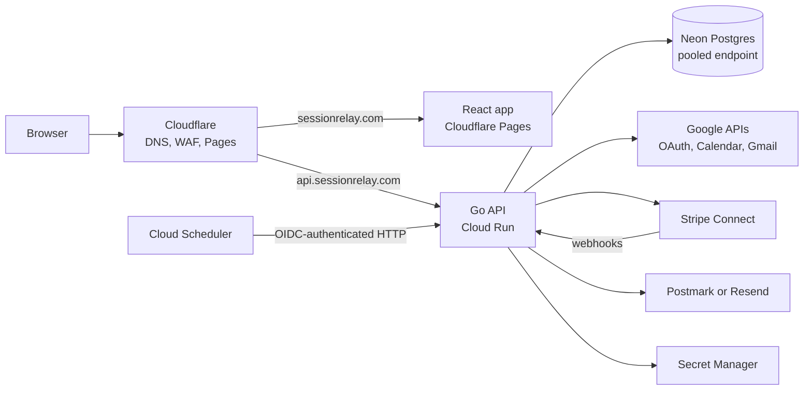

# Architecture

Rule: Cloudflare + Cloud Run + Neon. No Kubernetes, Redis, queues or other infrastructure until there is a demonstrated need.



## Stack

| Layer | Choice |
|---|---|
| Backend | Go, standard library `net/http` routing, `pgx` driver, `sqlc` for type-safe queries from hand-written SQL |
| API contract | OpenAPI spec, TypeScript types generated for the frontend |
| Migrations | Plain SQL files, applied by a migration tool in CI before traffic shifts |
| Frontend | React + TypeScript + Vite, TanStack Query for server state, React Hook Form + Zod, FullCalendar for calendar views, Tailwind |
| Database | Neon Postgres 17, `btree_gist` |
| Hosting | Cloud Run (API), Cloudflare Pages (frontend) |
| Jobs | Cloud Scheduler → authenticated HTTP endpoints on the API |
| Secrets | Google Secret Manager, mounted into Cloud Run |
| Email | Studio Gmail via Gmail API; platform mail via Postmark or Resend |
| Payments | Stripe Connect Standard |

Why Go + sqlc: the hard parts of this app are SQL (ranges, exclusion constraints, RLS) and state machines. sqlc keeps the SQL explicit and checked at compile time instead of hidden behind an ORM. Go gives small images and fast cold starts on a scale-to-zero platform.

## Domains

| Host | Serves |
|---|---|
| `sessionrelay.com` | Marketing page and the React app (Pages) |
| `sessionrelay.com/s/{slug}` | A studio's public booking page |
| `api.sessionrelay.com` | Go API on Cloud Run (CNAME) |
| `notifications@sessionrelay.com` | Platform sender; SPF, DKIM and DMARC records for the provider |

The app and API share the registrable domain, so the session cookie (`HttpOnly`, `Secure`, `SameSite=Lax`, `Domain=sessionrelay.com`) works without third-party cookie issues. CORS allows only `https://sessionrelay.com` with credentials.

## Request handling

1. Authenticate (session cookie from Google sign-in) or verify the signed token on public action routes.
2. Resolve the studio from the membership or slug.
3. Begin a transaction, `SET LOCAL app.studio_id`, run the handler, commit.
4. After commit, kick the outbox worker for the rows just written (best effort; the scheduled sweep guarantees delivery).

## Outbox

Anything with an external side effect (email, Calendar write, Stripe refund, Stripe invoice) is written to `outbox` in the same transaction as the state change that caused it. A worker:

- picks rows with `done_at IS NULL AND next_attempt_at <= now()` using `FOR UPDATE SKIP LOCKED`,
- performs the call with the row's `idempotency_key` passed to the provider where supported (Stripe),
- marks done, or schedules a retry with exponential backoff and records `last_error`,
- raises an alert after 10 failed attempts.

This gives at-least-once delivery without a queue service, and a state change can never commit without its notification, or send a notification for a change that rolled back.

## Scheduled jobs

Cloud Scheduler calls these endpoints with an OIDC token; the API checks the token's audience and service account.

| Endpoint | Every | Does |
|---|---|---|
| `/jobs/tick` | 1 min | Expire pending bookings, complete past sessions, send reminders and escalations, drain the outbox |
| `/jobs/google-poll` | 5 min | Refresh `google_busy` for connected engineers, flag conflicts |

Every job is idempotent and safe to run twice concurrently (row locks with `SKIP LOCKED`). Each successful run writes a heartbeat row.

## Signed links

Client actions use HMAC-SHA256 tokens:

```
payload = { studio_id, code (confirmation code or series id), action, quote_version, exp }
```

- Signed with a key from Secret Manager; the key id is in the token so keys can rotate.
- Verified for signature, expiry, action and, for quote actions, a matching `quote_version`.
- The state guard on the booking is the final check, so a valid token for a booking that has moved on does nothing harmful.
- Lifetimes are listed in [notifications.md](notifications.md).
- A link opens a landing page that shows what will happen and asks the client to confirm with a button that POSTs the token. Mail-client link scanners only issue GETs, so they can never accept, decline or cancel anything.

## Secrets

All in Secret Manager: database URLs, link-signing keys, token-encryption key, Google OAuth client secrets, Stripe keys and webhook secret, email provider key.

Google refresh tokens are encrypted with AES-256-GCM using a data key from Secret Manager before being stored; `google_grants.key_version` allows rotation. A database dump without the key reveals nothing usable.

## Environments

| | Staging | Prod |
|---|---|---|
| Cloud Run service | `sessionrelay-api-staging` | `sessionrelay-api` |
| Database | Neon branch of prod schema, resettable | Neon main branch |
| Frontend | Pages preview at a staging subdomain | `sessionrelay.com` |
| Google OAuth client | separate | separate |
| Stripe | test mode keys | live keys |

## CI/CD

GitHub Actions:

1. On every PR: lint, unit tests, integration tests against Postgres in testcontainers, `sqlc` diff check, OpenAPI type generation check, `docker build --platform=linux/amd64`.
2. On merge to `main`: build and push the image, run migrations on staging, deploy to staging.
3. Promote to prod by hand: run migrations on prod, deploy the **same image digest**.

Migrations must be backward compatible with the previous release (expand, then contract), because the old revision serves traffic while the new one starts.

## Testing

| Layer | Approach |
|---|---|
| Booking state machine | Integration tests against real Postgres: every allowed and refused transition, idempotent repeats |
| Double booking | Two concurrent inserts for the same engineer or room; exactly one commits |
| Tenant isolation | Studio A's context can never read or write studio B's rows, for every tenant table |
| Signed links | Wrong action, expired, tampered, and stale `quote_version` all rejected |
| Pure logic | Unit tests for TTL clamping, slot generation across DST changes, quote and deposit math, ranking |
| Google, Gmail, Stripe | Mocked at the HTTP boundary; Stripe webhook payloads from Stripe's fixtures |
| End to end | One manual run on staging per release through request, quote, deposit, booking, cancel with refund |

## Monitoring

Built-in GCP only:

- Cloud Logging with structured JSON logs (request id, studio id, booking id).
- Error Reporting for panics and 5xx.
- Uptime check on `api.sessionrelay.com/healthz` with email alert.
- Alert when no `/jobs/tick` heartbeat for 15 minutes; if expiry stops, holds never release.
- Alert when outbox rows exceed 10 attempts.
- Neon's point-in-time restore covers backups; check the retention window on the chosen plan.
