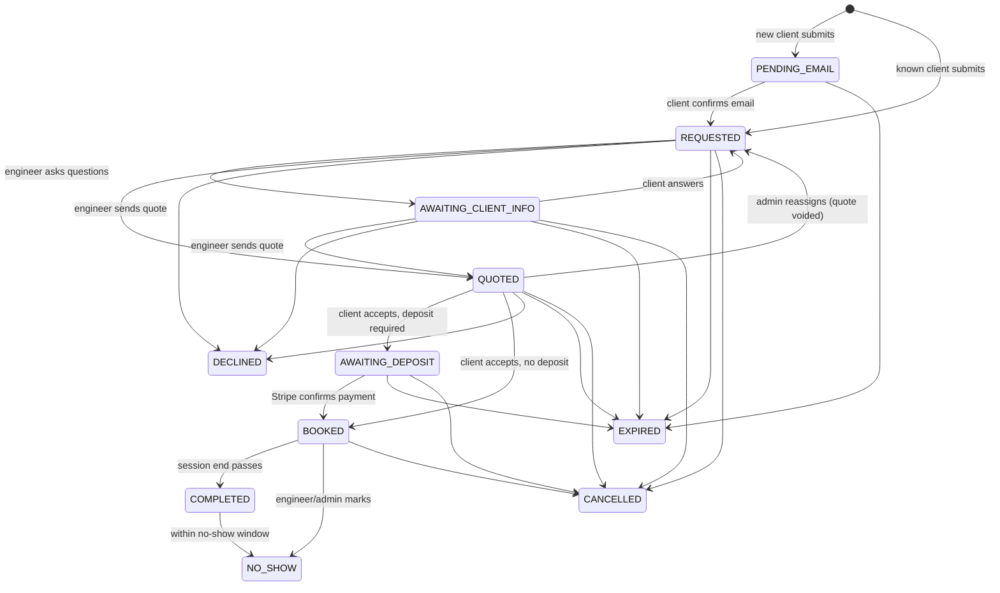

# Booking

## Lifecycle



| State | Blocks the slot | Who must act | TTL setting |
|---|---|---|---|
| `PENDING_EMAIL` | yes | client (confirm email) | `email_verify_minutes` (30) |
| `REQUESTED` | yes | engineer (claim, quote, ask, decline) | `ttl_requested_hours` (72) |
| `AWAITING_CLIENT_INFO` | yes | client (answer) | `ttl_awaiting_client_info_hours` (48) |
| `QUOTED` | yes | client (accept, decline) | `ttl_quoted_hours` (48) |
| `AWAITING_DEPOSIT` | yes | client (pay) | `ttl_awaiting_deposit_hours` (24) |
| `BOOKED` | yes | nobody | none |
| `COMPLETED` | no | engineer (close-out, see [payments.md](payments.md)) | none |
| `NO_SHOW` | no | nobody | none |
| `EXPIRED`, `DECLINED`, `CANCELLED` | no | nobody | none |

Money state is tracked separately in `payment_status`, never as booking states. "The session happened" and "the session is paid" are independent facts.

### Transitions

Every transition goes through one function in the booking package that:

1. Locks the row (`SELECT ... FOR UPDATE`).
2. Checks the current state against the allowed-from list. If the booking is already in the target state, returns success (idempotent retries and double clicks).
3. Computes the new `expires_at` (below) and rejects the transition if it would already be in the past.
4. Writes the new state, increments `quote_version` when a quote is created or voided, appends a row to `booking_events`, and enqueues side effects (emails, Calendar writes, Stripe calls) in the `outbox` table, all in one transaction.

Side effects never run inside the transaction. See [architecture.md](architecture.md#outbox).

### Expiry

```
expires_at = min(
  now + ttl_for_state,
  start_at - hold_cutoff_hours,
  created_at + max_hold_days
)
```

- If the result is not in the future, the transition is refused with a clear error ("too close to the session to request more info, please quote or decline").
- `hold_cutoff_hours` (24) means no pending hold survives to within a day of the session. A CHECK constraint requires `min_lead_time_hours > hold_cutoff_hours`.
- `max_hold_days` (14) stops request-info ping-pong from holding a slot indefinitely.
- Entering `BOOKED` or any terminal state clears `expires_at`.
- A job every minute moves rows with `expires_at < now()` in pending states to `EXPIRED` and enqueues the notifications.

## Availability

A start time is offered when **some** valid (engineer, room) pair is free for the whole requested duration.

An engineer is free when the interval is:

- inside their weekly working hours (`engineer_working_hours`, studio timezone), and
- not inside any OOO period, and
- not inside any Google busy block (`google_busy`), and
- not overlapping any of their bookings in a blocking state.

A room is free when the interval is inside studio business hours and does not overlap any of its bookings in a blocking state.

A pair is valid when the room allows the session type (`room_capabilities`) and the engineer lists the session type as a specialty (or, for a claim, has `can_claim_any`).

The client sees start times in `slot_step_minutes` (30) steps, between `now + min_lead_time_hours` (72) and `now + max_lead_time_days` (180). The client never sees why a time is unavailable, and never sees prices before a quote.

### Ranking

When several pairs are valid, rank by: room is preferred for the session type, then engineer specialty priority, then the engineer with fewer booked hours that week. The top pair is used as the provisional assignment (below).

### Double-booking prevention

The database enforces it with exclusion constraints on `bookings` (see [data-model.md](data-model.md)): no two blocking bookings may overlap for the same engineer, or for the same room. Two concurrent submissions for the same slot: exactly one insert commits, the other gets Postgres error `23P01` and the API returns "this time was just taken."

Google busy time and OOO live in other tables, so the constraint cannot cover them. Those are checked in application code inside the submit transaction, with a live Google free/busy call (see [google.md](google.md)). The remaining race (an engineer adds a personal event during the request) is handled as a conflict flag, below.

## Requesting a session

1. Client picks session type and duration (at least `min_session_minutes`), then a start time. "Any engineer" is the default; picking a named engineer is optional.
2. Client enters name, email, optional phone, notes. Cloudflare Turnstile protects the form.
3. Server validates everything again: lead time window, duration, eligibility, availability, active-hold limit (`max_active_holds_per_client`, a recurring series counts as one).
4. Booking is inserted with a provisional engineer and a room.
   - Known client (has a previous `BOOKED`, `COMPLETED` or `NO_SHOW` booking at this studio): state `REQUESTED`, engineers notified.
   - Otherwise: state `PENDING_EMAIL`. The client gets a "confirm your email" link. Confirming moves it to `REQUESTED` and only then notifies engineers. If not confirmed in 30 minutes it expires silently.

### Named engineer vs. any engineer

- **Named**: `requested_engineer_id` and `engineer_id` are both that engineer. Only they (or an admin) act on it.
- **Any**: the system assigns the best-ranked free engineer as a **provisional** `engineer_id` so the exclusion constraint protects capacity, and leaves `claimed_at` null. The request shows in the queue of every engineer who is eligible and free at that time.

### Claiming

An eligible engineer clicks "Claim." One conditional update decides the winner:

```sql
UPDATE bookings
SET engineer_id = $me, claimed_at = now()
WHERE id = $id AND claimed_at IS NULL AND status IN ('REQUESTED', 'AWAITING_CLIENT_INFO');
```

If `$me` is not the provisional engineer, the exclusion constraint checks that `$me` is free; the provisional engineer is released by the same statement. Zero rows updated means someone else claimed first. The client is told "Assigned to [name]."

Engineers with `can_claim_any` may claim "any engineer" requests outside their listed specialties. They may not take requests addressed to a named engineer; only admins reassign those.

### Asking for more info

`REQUESTED → AWAITING_CLIENT_INFO`. The engineer's questions go to the client with a signed "answer" link. The client's answer moves it back to `REQUESTED` with a fresh TTL (still clamped) and notifies the engineer.

### Quoting

The quote form shows:

```
room_rate    = room_rates[room, session_type] or room_rates[room, default]
engineer_rate = engineer_rates[engineer, session_type]
subtotal     = (room_rate + engineer_rate) × hours
quoted_amount = subtotal + adjustment          (adjustment may be negative)
deposit      = round(quoted_amount × deposit_percent / 100), unless exempt
```

The engineer can apply an adjustment with a reason, waive the deposit for this quote, and add a note to the client. Sending the quote stores every component on the booking, increments `quote_version`, sets `QUOTED`, and emails accept/decline links bound to that version.

### Accepting

The accept link carries a signed token with the current `quote_version`. Accepting:

- checks the token's action, signature, expiry, and that `quote_version` matches the booking (old links from a voided quote are rejected),
- moves to `AWAITING_DEPOSIT` if a deposit is due, or straight to `BOOKED` if not.

### Declining

- Engineer declines (`REQUESTED`, `AWAITING_CLIENT_INFO`, `QUOTED`) with a reason code and optional text, and may suggest up to 3 alternative times. Alternatives are emailed only (not stored); each has a "request this slot" link that pre-fills a new request.
- Client declines a quote with an optional reason.

## Reassignment (admins)

| From state | Effect |
|---|---|
| `REQUESTED`, `AWAITING_CLIENT_INFO` | New engineer must be free (constraint). Client notified. |
| `QUOTED` | Quote voided, `quote_version` incremented, back to `REQUESTED` for the new engineer to re-quote. TTL resets (clamped). Client notified. |
| `BOOKED` | New engineer must be free. Price unchanged. Client notified. |

## Conflicts from Google Calendar

If a Google busy block appears over an existing blocking booking, the booking gets `conflict_flagged_at`, the engineer and admins see it in their dashboards, and the engineer gets one email. **No action is taken toward the client.** The engineer resolves it with decline, cancel, reschedule, or by moving the personal event. Busy blocks from all-day events and events marked "free" are ignored.

## OOO

OOO is a deliberate statement made in SessionRelay, so it acts:

- On save, overlapping holds (`PENDING_EMAIL` through `AWAITING_DEPOSIT`) are auto-declined with `DECLINED_DUE_TO_ENGINEER_OOO`; clients get the decline email with alternatives where available.
- Overlapping `BOOKED` sessions block the save until the engineer cancels or reschedules each one, or shortens the OOO. The UI lists them with a "suggest reschedule" action.
- OOO can be added retroactively.

## Reminders and escalation

- Halfway through a `REQUESTED` TTL: reminder to the assigned engineer (or to the queue if unclaimed).
- 24 hours before a `REQUESTED` expires with no engineer action: escalation to studio owner and admins with "claim/assign," "quote," "decline" actions in the dashboard. Recorded in `bookings.escalated_at`.

## Recurring series

A client can request a weekly or bi-weekly series with an end date. Only occurrences inside the booking window are created. Before submit, the client sees which dates are unavailable and can drop them or abort.

- All occurrences share a `series_id` and one engineer and room.
- The engineer quotes the series once; every pending occurrence becomes `QUOTED` with the same `quote_version`.
- The client accepts the series once; one deposit is computed on the series total.
- After booking, single occurrences can be cancelled, rescheduled or marked no-show independently. Refunds for a single cancelled occurrence follow the normal refund rules for that occurrence's share of the deposit.

## Rescheduling

A reschedule is a new booking linked to the original; the original is never edited in place.

1. Client (signed link) or engineer starts a reschedule. Refused if the original already has an active reschedule in flight.
2. New booking created in `REQUESTED` with `rescheduled_from_id`; original stays `BOOKED`.
3. Normal quote flow. When the new booking reaches `BOOKED`, the original moves to `CANCELLED` with `CANCELLED_DUE_TO_RESCHEDULE` **in the same transaction**, and the deposit moves to the new booking (no refund, no new charge).
4. If the new booking expires or is declined, the original stays `BOOKED`.

## Cancellation

- Client: pending states (withdraw) and `BOOKED`, via signed link.
- Engineer or admin: any non-terminal state, from the dashboard.
- Refund rules: [payments.md](payments.md#refunds).

## No-show and completion

- A job moves `BOOKED` to `COMPLETED` once `end_at` passes.
- An engineer or admin can mark `NO_SHOW` within `no_show_window_days` (7) of the session, from `BOOKED` or `COMPLETED`. The deposit is kept. The client's no-show count shows on their record so the studio can revisit deposit exemptions.

## Reason codes

| Code | Status | Set by |
|---|---|---|
| `DECLINED_DUE_TO_ENGINEER_OOO` | DECLINED | system |
| `DECLINED_BY_ENGINEER_UNAVAILABLE` | DECLINED | engineer |
| `DECLINED_BY_ENGINEER_OTHER` | DECLINED | engineer |
| `DECLINED_BY_CLIENT_QUOTE` | DECLINED | client |
| `CANCELLED_BY_CLIENT` | CANCELLED | client |
| `CANCELLED_BY_ENGINEER` | CANCELLED | engineer |
| `CANCELLED_BY_ADMIN` | CANCELLED | admin |
| `CANCELLED_DUE_TO_RESCHEDULE` | CANCELLED | system |
| `CANCELLED_DUE_TO_ENGINEER_OOO` | CANCELLED | engineer |

`EXPIRED` needs no code.

## Client-facing links

Every client action happens through a signed, time-bound, action-scoped token. See [architecture.md](architecture.md#signed-links). The confirmation code (e.g. `BK-A7X9-K4M2`) only allows read-only status lookup; it never changes state.
